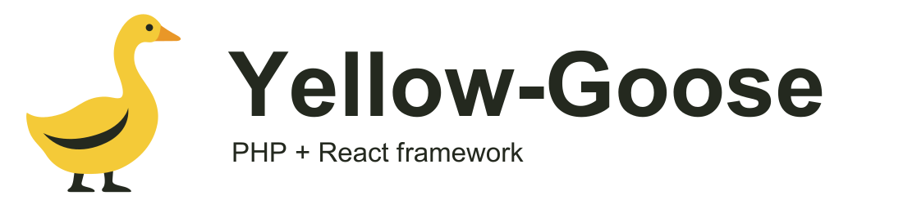

# Żółta-Gąska / Yellow-Goose

<picture>
  <source media="(prefers-color-scheme: dark)" srcset="public/brand/logo-dark.svg">
  
</picture>

Framework PHP + React: routing plikowy, loadery PHP, JSON API, ORM i SSR.
Rdzeń jest pakietem Composer w `packages/framework/`.
Demonstracja: notatnik z listą, szczegółami, dodawaniem, edycją, usuwaniem i paginacją.

## Uruchomienie

PHP 8.1+ z PDO, pdo_sqlite i mbstring, Composer, Node 24 LTS i npm.
SSR wymaga Node podczas obsługi żądań oraz dostępnego proc_open w PHP.
UI: React / React DOM 19.3.1, Vite 8.3.8, plugin-react 6.3.0.

Pierwsza instalacja:

```sh
composer install
npm ci
php gaska db:migrate
```

Development — **jedna komenda, jeden terminal**:

```sh
npm run dev
```

Otwórz http://127.0.0.1:8000. Vite na 5173 dostarcza HMR.
Ctrl+C zatrzymuje środowisko. Awaria jednego procesu zatrzymuje drugi i zwraca błąd.
Inne porty: `npm run dev -- --port=8080 --vite-port=5174`.
Start development nie wykonuje migracji ani nie zmienia danych.

Demonstracja builda z SSR:

```sh
npm run demo
```

Komenda wykonuje migracje, dodaje dwa wpisy **tylko do pustej bazy**,
buduje frontend i SSR, następnie uruchamia PHP na porcie 8000.
Zatrzymaj wcześniej development. Domyślna baza: `database/database.sqlite`.
Można też wykonać `npm run build` i `php gaska serve` osobno.
Opcjonalną konfigurację opisuje .env.example; nie nadpisuj istniejącego .env.

## Tryby renderowania

| Tryb | Działanie |
| --- | --- |
| `npm run dev` | CSR + Vite HMR |
| `npm run build` + `php gaska serve` | PHP loader → React SSR w Node → HTML → hydracja |
| `GASKA_SSR=0 php gaska serve` | Jawne wyłączenie SSR, frontend z builda |

SSR zwraca treść przed wykonaniem JavaScript. Formularze i przyciski wymagają hydracji.
Pierwsza wersja uruchamia proces Node na każde żądanie strony, z timeoutem 5 s
i limitami danych. Nie ma jeszcze puli workerów ani streamingu.
API nie zależy od dostępności builda SSR.

## Struktura

| Katalog | Zawartość |
| --- | --- |
| `packages/framework/src/` | Routing, HTTP, ORM, konfiguracja, CLI, integracja SSR |
| `packages/framework/resources/` | Runtime React, Vite, supervisor i runner SSR |
| `app/pages/` | Strony React; API w podkatalogu api |
| `app/loaders/` | Dane stron z PHP |
| `app/components/` | Komponenty aplikacji |
| `database/` | Migracje, seed i lokalna baza |
| `public/build/` | Publiczne zasoby klienta |
| `build/ssr/` | Prywatny bundle serwerowy, poza document root |

Aplikacja instaluje yellow-goose/framework przez repozytorium Composer typu path.
Kod App nie jest częścią pakietu. Test niezależnego konsumenta instaluje fizyczną kopię
pakietu i buduje własną stronę, loader i API. Pakiet nie jest opublikowany w Packagist.

Dokumentacja: [pakiet](docs/framework-package.md), [SSR](docs/ssr.md),
[routing](docs/routing.md), [loadery](docs/data-fetching.md), [API](docs/api-routes.md),
[ORM](docs/orm.md), [konfiguracja](docs/configuration.md), [CLI](docs/cli.md).

Logo, warianty i pliki źródłowe: [identyfikacja frameworka](docs/branding.md).

## Aplikacja i API

| Adres | Funkcja |
| --- | --- |
| /, /?page=2 | Lista po 10 wpisów |
| /posts/new | Dodawanie |
| /posts/{id} | Szczegóły i usuwanie |
| /posts/{id}/edit | Edycja |
| GET /api/posts | Lista JSON |
| POST /api/posts | Utworzenie; 201 i Location |
| GET /api/posts/{id} | Szczegóły JSON |
| PATCH /api/posts/{id} | Częściowa aktualizacja |
| DELETE /api/posts/{id} | Usunięcie; pusty 204 |
| GET /api/hello | Kontrola połączenia |

POST/PATCH wymagają obiektu JSON: title (1–200 znaków), content (1–10000).
Walidacja zwraca 422 z mapą errors; nieznane pola są odrzucane.
Mutacje wymagają sesji i nagłówka X-CSRF-Token. Token trafia do props strony.

## Testy

Kontrole bez portów sieciowych (Python 3, php-cgi i Node):

```sh
npm run verify
```

Obejmuje testy PHP, oba buildy, supervisor, SSR, rzeczywisty entry point przez CGI
oraz instalację pakietu w niezależnej aplikacji. Testy używają tymczasowych baz.
Test pakietu współdzieli lokalne node_modules; nie zastępuje czystego npm ci.

Pełne E2E — jednorazowo przygotuj Playwright:

```sh
python3 -m venv .venv
source .venv/bin/activate
python -m pip install -r requirements-dev.txt
python -m playwright install chromium
npm run verify:all
```

Na Linuxie można użyć `python -m playwright install --with-deps chromium`.
PLAYWRIGHT_CHROMIUM_EXECUTABLE opcjonalnie wskazuje istniejący Chrome/Chromium.
E2E wybiera wolne porty i uruchamia serwery w tymczasowej kopii projektu.
Sprawdza SSR bez JS, hydrację, CRUD, trwałość po restarcie, błędy, mobile
i HMR przez pojedynczą komendę development. Zrzuty i trace: `test-results/`.

Workflow [tests.yml](.github/workflows/tests.yml): PHP 8.1/8.5, MySQL 8.4,
czysta instalacja npm, verify oraz Chromium E2E.

### Lokalna weryfikacja — 2026-11-12

- PHP/SQLite: 145 asercji PASS.
- PHP-CGI: 37 asercji PASS, w tym HTML SSR, escapowanie, sesja i CRUD.
- SSR: 20 asercji PASS, w tym timeout, limity, sprzątanie procesu i błędy.
- Supervisor: 4 testy PASS, w tym awaria, SIGINT/SIGTERM i wymuszone zakończenie.
- Build klienta i SSR oraz niezależny konsument Composer: PASS.
- E2E i start serwerów: **zablokowane przez sandbox** (Operation not permitted przy nasłuchiwaniu).
- MySQL: Docker odmawia dostępu, brak lokalnego serwera. Repozytorium CI: [bula-lab/yellow-goose](https://github.com/bula-lab/yellow-goose); pełne zielone CI nie jest jeszcze potwierdzone.
- Czyste npm ci: poprzednia próba offline wykazała niepełny cache (ENOTCACHED); brak dostępu do rejestru.
- node_modules pozostaje śledzone w Git; zapis .git/index.lock jest zablokowany.
  Poza tym środowiskiem `git rm -r --cached -- node_modules` usuwa je z indeksu, zachowując pliki lokalnie.

## Granice

Lokalna demonstracja, bez kont i autoryzacji prywatnych danych.
Brak SSG/ISR, RSC, RPC „Zero API” i rozbudowanych relacji ORM.
Wbudowany serwer PHP służy do developmentu. Przy innym serwerze document root musi
wskazywać `public/`; żądania aplikacji kieruj do index.php i blokuj pliki ukryte,
w szczególności `public/build/.vite/`.

[Plan i status](docs/mvp.md) · [Pierwotna wizja](docs/vision.md)
