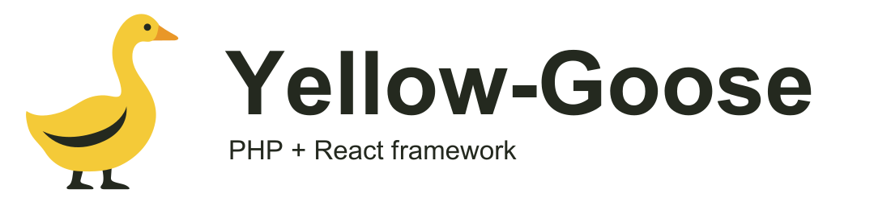

# Logo Yellow-Goose

<picture>
  <source media="(prefers-color-scheme: dark)" srcset="../public/brand/logo-dark.svg">
  
</picture>

Znak: żółta gąska z długą szyją, pomarańczowym dziobem i prostym ciemnym skrzydłem.
Wariant z nazwą używa podpisu „PHP + React framework”.

## Pliki

| Zastosowanie | SVG | PNG |
| --- | --- | --- |
| Symbol na jasne tło | [icon-light.svg](../public/brand/icon-light.svg) | [512 px](../public/brand/icon-light.png) |
| Symbol na ciemne tło | [icon-dark.svg](../public/brand/icon-dark.svg) | [512 px](../public/brand/icon-dark.png) |
| Logo z nazwą na jasne tło | [logo-light.svg](../public/brand/logo-light.svg) | [1100 × 256](../public/brand/logo-light.png) |
| Logo z nazwą na ciemne tło | [logo-dark.svg](../public/brand/logo-dark.svg) | [1100 × 256](../public/brand/logo-dark.png) |
| Favicon | [SVG z obsługą motywu systemowego](../public/favicon.svg) | [ICO 16/32/48](../public/favicon.ico) |

Dodatkowe ikony PNG: 16, 32, 180, 192 i 512 px w public/brand.
PNG mają przezroczyste tło. SVG zawierają prawdziwe ścieżki wektorowe;
napisy w pełnym logo są zamienione na krzywe i nie wymagają instalacji fontów.

## Paleta i użycie

| Kolor | HEX | Rola |
| --- | --- | --- |
| Żółty | #F4CA38 | Korpus gąski |
| Atrament | #24291F | Skrzydło, oko i tekst na jasnym tle |
| Pomarańczowy | #E99728 | Dziób |
| Jasny | #F7F7EF | Tekst i nogi w wariancie na ciemne tło |

Zachowuj proporcje i wolną przestrzeń wokół znaku. Dla małych rozmiarów używaj
samej gąski; pełne logo z podpisem zalecane od szerokości 280 px.
Ikona została obejrzana w rozmiarze 32 px; dostępna jest także wersja 16 px.

Aplikacja używa symbolu w nagłówku. config/app.php definiuje favicon i ikonę
Apple Touch. README dobiera wariant logo do motywu systemowego.

## Źródła i ponowny eksport

- Koncepcja wygenerowana graficznie: assets/brand/logo-concept.png.
- Uproszczone ścieżki wektorowe: assets/brand/logo-paths.json.
- Źródło eksportera: scripts/export-brand.py.
- Pliki gotowe do użycia: public/brand oraz public/favicon.svg i public/favicon.ico.

Ponowny eksport: `python3 scripts/export-brand.py`.
Wymaga Pillow i natywnego Cairo; nie są potrzebne do uruchomienia aplikacji.
Eksporter tworzy SVG z krzywymi oraz rasteryzacje PNG/ICO z tych samych ścieżek.
Wygenerowany koncept pozostaje oddzielnym plikiem źródłowym.

Sprawdzono poprawność XML SVG, kanał przezroczystości PNG i rozmiary favicon ICO.
Test CGI potwierdza obecność logo oraz odnośnika favicon w HTML przed JavaScript.
E2E sprawdza pobieranie favicon i symbolu przez HTTP oraz załadowanie logo w przeglądarce.
Potwierdzenie wykonania w CI: [akceptacja MVP](mvp.md#akceptacja-w-ci--2026-11-13).
