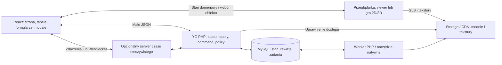

# Rozbudowa Yellow-Goose: CMS, gry i edytor 3D

Plan z 2026-11-13, poprawiony po walidacji 2026-11-18; baza analizy b1e8000.

Aktualny stan: A0, A1 i A2 wdrożone oraz zweryfikowane w lokalnym drzewie roboczym.
Następny etap: B1. [Raport wykonania](a0-a2-implementation-2026-11-18.md).
Poniższy opis stanu początkowego i bramek zachowuje kontekst pierwotnej analizy.
Dokument jest roadmapą. Można rozpocząć inwentaryzację A0; zgodna ekstrakcja A1
wymaga najpierw sprawdzonej macierzy eksportów i konsumentów A0. Dalsze fale mają
bramki danych i infrastruktury opisane w sekcji 13.
Nie jest to akceptacja wydajności importu CAD ani serwera gry.

Dokumenty towarzyszące: [pakiety i migracja](package-architecture-2026-11-18.md),
[porównanie z ekosystemami](framework-comparison-2026-11-18.md),
[wynik walidacji](3d-plan-validation-2026-11-18.md).

YG powinien dostarczać wspólne mechanizmy aplikacji: tożsamość, uprawnienia,
zasoby, walidację, komendy, formularze, tabele i trwały obszar roboczy.
Renderowanie 3D należy oprzeć na gotowym silniku działającym w przeglądarce.
Reguły budowy garażu, ekonomia gry i geometria ogrodu pozostają w aplikacjach.

## 1. Zakres i decyzje

| Wymaganie | Źródło | Decyzja projektowa |
| --- | --- | --- |
| Strona WWW i CMS jak Solidne-Garaże | Prośba użytkownika | Publiczne strony SSR, zasoby 3D, katalog, konfigurator i panel redakcyjny |
| Gra 2D/3D z tabelami i modalami | Prośba i odpowiedź użytkownika | Obsługa strategii asynchronicznej oraz rozgrywki na żywo; różne mechanizmy synchronizacji |
| Portal modeli domów, planów i ogrodów | Prośba i odpowiedź użytkownika | Przeglądanie i edycja sceny; import gotowych modeli oraz plików projektowych |
| Node wyłącznie do builda/developmentu | Wcześniejsza decyzja użytkownika | PHP obsługuje HTTP; WebGL działa w przeglądarce; serwerowe usługi opcjonalne bez Node |
| Edycja sceny | Odpowiedź użytkownika | Zapis, autosave, cofanie, rewizje, konflikty i uprawnienia |
| Jednoczesna współedycja | Nieustalone | Brak współedycji na żywo w pierwszej wersji; równoległe sesje chroni konflikt rewizji. Wyłączna dzierżawa nie jest domyślnym ograniczeniem |
| Podział na niezależne pakiety | Decyzja użytkownika 2026-11-18 | Osobne manifesty Composer/npm, fasada zgodności i opcjonalne moduły; szczegóły w planie pakietów |
| Dokładność CAD, wymiarowanie produkcyjne | Nieustalone | Viewer i kompozycja sceny nie oznaczają pełnego edytora CAD ani certyfikowanej dokumentacji wykonawczej |

Oba tryby gry i oba rodzaje importu są w zakresie docelowym. Nie trzeba wdrażać ich
równocześnie. Wspólna baza powinna powstać na jednym działającym przekroju produktu.

## 2. Zweryfikowany stan YG

| Obszar | Dowód w repozytorium | Znaczenie dla rozbudowy |
| --- | --- | --- |
| SSR bez Node | [V8JsRenderer](../../packages/php/ssr-v8js/src/Frontend/V8JsRenderer.php), [runtime](../../packages/framework/src/Runtime.php) | V8Js renderuje interfejs, ale nie zapewnia DOM, WebGL ani GPU |
| Eager import stron na serwerze | [app/server.jsx](../../app/server.jsx) | Strona nie może importować silnika zależnego od przeglądarki na poziomie modułu |
| Nawigacja montuje nową stronę | [client.jsx](../../packages/framework/resources/client.jsx), key oparty na numerze wizyty | Zmiana widoku obecnie niszczy stan komponentu; potrzebny trwały WorkspaceShell |
| Małe dane JSON | [Request](../../packages/php/core/src/Http/Request.php), limit 1 MiB | Pliki modeli nie mogą iść jako JSON/Base64; brak gotowego kontraktu uploadu |
| Odpowiedź ma body typu string | [Response](../../packages/php/core/src/Http/Response.php) | Brak gotowego strumieniowania dużych plików; pobieranie delegować storage/webserwerowi |
| CSRF, bez tożsamości i polityk zasobów | [Session](../../packages/php/security/src/Security/Session.php), [Application](../../packages/php/react-bridge/src/Http/Application.php) | Konta i autoryzacja muszą poprzedzić publiczny CMS, prywatne sceny i grę |
| Prosty ORM i pojedyncze PDO | [Builder](../../packages/php/database/src/Database/Builder.php), [Connection](../../packages/php/database/src/Database/Connection.php) | Potrzebne transakcje, warunkowy zapis rewizji, indeksy i repozytoria domenowe |
| Brak usług zadań i zdarzeń | Zawartość packages/framework/src i komendy CLI | Import, terminy gry i eksport wymagają kolejki/workerów lub wariantu cron |

Historyczne źródło Solidne-Garaże potwierdza definicje pól CMS w
admin_off/c/app/gbp/gbp_formularz_extends.php:64–68 (cms_formularze/cms_formularze_pola),
reguły parametrów/cen w js/kreator.js:146–282 i scenę Babylon w
v/kreator-webgl.php:314–323. Sprawdzono te pliki read-only w przekazanym projekcie
solidne-garaze.pl. To źródło pomysłów, nie funkcje dostępne w YG ani potwierdzenie
aktualnych cen/reguł. Przeniesienie zachowania wymaga fixture i decyzji domenowej
przed B2; nie kopiujemy globalnego stanu ani SQL składanego w widoku/helperze.

## 3. Wspólna architektura



Dla szybkiej gry proces symulacji korzysta z tych samych polityk i reguł domenowych,
ale nie wykonuje żądania HTTP do PHP dla każdej klatki/ticku. Połączenie RT–API
na diagramie oznacza integrację usług, nie obowiązkowy round-trip każdego ruchu.

Logiczne moduły:

| Moduł | Odpowiedzialność | Granica |
| --- | --- | --- |
| Core | HTTP, routing, konfiguracja i jawny kontrakt rozszerzeń | Bez PDO, V8Js, React i domen; transakcje oraz polityki mają własne pakiety |
| Data/UI | Schematy zasobów, Form, DataTable, Dialog, walidacja, obsługa komend | Komponenty HTML/React niezależne od silnika |
| Assets | Upload, wersje plików, dostęp, pochodne, status przetwarzania | Pliki w storage; metadane w SQL |
| Scene | Kontrakt sceny, lifecycle viewportu, wybór obiektu, adapter silnika | Stan domenowy nie zależy od serializacji konkretnego silnika |
| Jobs/Events | Zadania, retry, idempotencja, outbox, odbudowa stanu po reconnect | Transport zdarzeń wymienialny |
| CMS / Game / Design | Reguły, modele i operacje konkretnego produktu | Moduły aplikacji korzystające z powyższych mechanizmów |

Pierwszy etap wydziela istniejący kod do osobnych bibliotek Composer:
core, database, react-bridge, ssr-v8js; framework pozostaje fasadą zgodności.
Frontend i narzędzia builda trafiają do oddzielnych pakietów npm react i vite.
Kolejne funkcje powstają w osobnych opcjonalnych pakietach, a nie we framework-fasadzie.
Każdy pakiet ma manifest, eksporty i niezależnego konsumenta; na początku pozostają w monorepo.
[Własność, DAG, profile instalacji i kolejność](package-architecture-2026-11-18.md).
Silnik 3D pozostaje opcjonalną zależnością adaptera; zwykły CMS go nie pobiera.

## 4. Renderowanie 3D a SSR

SSR zwraca opis produktu, formularz, tabele, rozmiary kontenera oraz poster.
Pierwszy render klienta zwraca ten sam widok. Dopiero po mount wykonywany jest
import silnika i uruchomienie canvas. Sam warunek typeof window nie wystarczy,
jeśli silnik został już zaimportowany na poziomie modułu strony.

Potrzebny komponent ClientOnly/Viewport z dynamicznym importem po stronie klienta,
obsługą braku GPU, ładowania, błędu dekodera i utraty kontekstu graficznego.
Build SSR powinien dostać stub viewportu zamiast modułu silnika; build klienta
ładuje właściwy adapter osobnym chunkiem. Sam lazy import nie jest dowodem,
że kod browser-only nie trafił do samodzielnego bundle'a SSR.
Podgląd statyczny musi działać także bez JavaScriptu.

Jako pierwszy adapter proponuję Babylon.js: ma scenę, kamery, picking, animacje,
kolizje i obsługę WebGL/WebGPU, a stary konfigurator już korzysta z jego modelu pracy.
To wybór do prototypu i pomiarów, nie stwierdzenie przewagi wydajności.
[Zakres Babylon.js](https://www.babylonjs.com/specifications/).

Three.js z React Three Fiber pozostaje alternatywą, jeżeli ważniejszy okaże się
sposób składania sceny w React. Nie wdrażamy obu adapterów naraz.
Dla statycznego viewera renderowanie na żądanie ogranicza niepotrzebną pracę;
gra z ciągłym ruchem potrzebuje pętli animacji.
[Renderowanie na żądanie](https://r3f.docs.pmnd.rs/advanced/scaling-performance).

Interfejs adaptera obejmuje tylko to, czego używa aplikacja: mount/dispose,
loadAsset, select, focus, applyChanges, capturePreview i zdarzenia interakcji.
Nie tworzymy abstrakcji całego API Babylon/Three. Gra stricte 2D może korzystać
z osobnego adaptera Canvas/WebGL lub zwykłej mapy HTML, zachowując komendy i UI.

## 5. Pliki 3D i dostarczanie zasobów

Rozdzielamy cztery rodzaje danych:

| Dane | Przykład | Dostarczanie |
| --- | --- | --- |
| Model i tekstury | GLB, KTX2, obrazy | Storage/CDN; wersjonowany URL |
| Definicja sceny | Instancje, identyfikatory, transformacje, materiały | Stronicowany manifest/snapshot JSON |
| Interakcja | Zmień kolor, przesuń obiekt, rozpocznij budowę | Mała komenda JSON; w szybkiej grze wiadomość wejściowa |
| Wynik operacji | Nowa rewizja, zmienione pola, zdarzenia | Odpowiedź HTTP i opcjonalnie push |

Format dostarczenia geometrii: glTF 2.0, zwykle GLB. GLB może zawierać zależności
w jednym pliku, ale sam wybór rozszerzenia nie gwarantuje braku zewnętrznych URI.
Import musi sprawdzać odwołania. glTF używa metrów, osi Y w górę i układu prawoskrętnego;
adapter normalizuje układ silnika. Nazwy węzłów nie są unikalnymi identyfikatorami.
[Specyfikacja glTF](https://registry.khronos.org/glTF/specs/2.0/glTF-2.0.html).

Dla tekstur przewidujemy KTX2/Basis, a dla geometrii jedną wybraną kompresję,
np. Meshopt. Draco jest alternatywą, nie obowiązkową drugą kopią każdego modelu.
Wybór zależy od dekoderów, jakości i czasu uruchomienia na docelowych urządzeniach.
[Kompresor Khronos](https://github.com/KhronosGroup/glTF-Compressor).
Ta dokumentacja nie jest wyborem produkcyjnego narzędzia ani dowodem braku Node.
Każdy etap uploadu użytkownika działa również produkcyjnie bez Node: walidacja
może użyć natywnego gltf_validator, a optymalizacja np. natywnego gltfpack.
Wersje, formaty i limity trzeba sprawdzić na docelowym obrazie workera. gltfpack
może scalać i usuwać węzły, więc zachowanie mapowania entityId/BIM jest osobnym testem.
Narzędzia CLI wymagające Node, np. glTF Transform CLI, pozostają do build/dev;
nie stają się dozwolone przez przeniesienie do osobnego serwera workerów.
[Natywny walidator](https://github.com/KhronosGroup/glTF-Validator#cli-tool),
[natywny gltfpack](https://github.com/zeux/meshoptimizer/blob/master/gltf/README.md),
[glTF Transform CLI](https://gltf-transform.dev/cli).

Ścieżka uploadu:

1. PHP sprawdza konto, rolę, limit i docelowy projekt, po czym tworzy sesję uploadu.
2. Przeglądarka wysyła plik bezpośrednio do storage. Alternatywa lokalna:
   kontrolowany upload multipart do pliku tymczasowego, bez buforowania modelu jako JSON.
3. Finalizacja sprawdza właściciela i zamraża konkretną wersję bajtów w prywatnej
   kwarantannie. Dla wersjonowanego storage zapisuje VersionId i jawny checksum.
   W innym storage wymagana jest gwarantowana kopia warunkowa/atomowe przejęcie
   do klucza, do którego klient nie ma prawa zapisu; walidujemy już przejętą kopię.
4. Worker odczytuje dokładnie zamrożoną wersję i weryfikuje rozmiar, checksum,
   rzeczywisty format i odwołania; wykonuje jawnie wybrany profil pochodnych.
   Pierwszy profil B1 rekomenduje gotowy GLB z osobno dostarczonym, zweryfikowanym
   posterem. Automatyczne generowanie postera wymaga wybranego renderera bez Node
   i osobnego testu; sam V8Js ani walidator glTF nie renderuje obrazu.
5. Wynik trafia do nowego niezmiennego klucza serwerowego, bez wydanego klientowi
   PUT. Status przechodzi queued → processing → ready/failed; viewer nigdy nie czyta staging.
   Retry jest idempotentne. Nowy import tworzy nową wersję, nie nadpisuje geometrii ready.

Presigned URL pozwala wysłać plik do wskazanego obiektu bez przekazywania klientowi
kluczy storage. Klucz musi być nowy i nadany przez serwer, ponieważ upload pod istniejący
klucz może nadpisać obiekt. Limity sprawdzamy także przy finalizacji; sam podpis PUT
nie zastępuje walidacji rozmiaru i formatu. Podpis może być użyty ponownie przed
wygaśnięciem: unikalny klucz sesji nie zamraża jeszcze zaakceptowanego pliku.
ETag nie jest domyślnie utożsamiany z checksum całej zawartości.
[Wielokrotne użycie podpisu](https://docs.aws.amazon.com/AmazonS3/latest/userguide/using-presigned-url.html),
[upload przez podpisany URL](https://docs.aws.amazon.com/AmazonS3/latest/userguide/PresignedUrlUploadObject.html).

Przetwarzanie wymaga minimalnego jobs/worker przed pierwszą publikacją pochodnych.
Nie odkładamy tego konsumenta dopiero do importu CAD. Alternatywny przyrost bez
workera musiałby jawnie przyjmować gotowy GLB i poster, bez obietnicy automatycznej konwersji.

Duże pliki: upload częściami z wznowieniem i sprzątaniem porzuconych sesji.
Pliki publiczne o niezmiennym kluczu mogą mieć długi cache; prywatne wymagają
odpowiedniej polityki dostępu i cache, niezależnej od publicznego CDN.
Metadane sceny nie zawierają stałego uprawnienia do oryginału CAD.
Domyślnie oryginały są prywatne. Unpublish treści nie jest równoznaczne z odwołaniem
już wydanego URL: prywatny podpis działa do upływu TTL, a publicznej kopii z długim
cache nie można natychmiast wycofać. Politykę publikacji assetu ustala się osobno.

Nie przesyłamy GLB przez props SSR, Base64 ani zdarzenia WebSocket.
Nie zapisujemy binarnej geometrii jako domyślnego BLOB w tabeli aplikacji.
Range obsługuje storage/webserwer; nie oznacza to automatycznego streamowania
poziomów szczegółowości jednego GLB. Duże sceny dzielimy na osobne zasoby/strefy.

Walidacja glTF, limity tekstur, geometrii i rozpakowanych danych poprzedzają publikację.
Importer nie pobiera dowolnych URL z pliku. Worker ma ograniczone CPU/RAM/czas
oraz ograniczony dostęp do sieci. Nie dopuszczamy skryptów ani shaderów przesyłanych
jako kod użytkownika. [Walidator glTF](https://github.com/KhronosGroup/glTF-Validator).

## 6. Stan sceny, jednostki i komendy

Trwały dokument sceny zawiera: schemaVersion, sceneId, revision, lokalny układ
współrzędnych, referencje do wersji assetów i encje ze stabilnym entityId.
Encja ma typ, rodzica, transformację i właściwości domenowe.
Nie zapisujemy całego obiektu Scene/Mesh silnika jako jedynego źródła danych.
Mapowanie mesh–entityId pozwala połączyć wybór w 3D z tabelą i formularzem.
W BIM przechowujemy również identyfikator elementu źródłowego.

Przykład kontraktu parametrycznego garażu, nie istniejący fixture aplikacji:

| Granica | Reprezentacja wysokości |
| --- | --- |
| Formularz | 213 cm |
| API i trwały stan projektu | heightMm = 2130, liczba całkowita |
| Adapter viewera | 2130 / 1000 = 2.13 m |
| Etykieta po ponownym odczycie | 2130 / 10 = 213 cm |

Parametry garażu mogą używać całkowitych mm. Nie narzucamy tej kwantyzacji
wszystkim źródłom CAD/BIM: transformacja sceny używa jawnych metrów oraz ustalonej
precyzji; importer zachowuje źródłowe jednostki i dokładność oryginału.
Kąty i quaterniony mają osobny typ i reguły walidacji. Wszystkie liczby są skończone,
mają dozwolone zakresy; hierarchia nie może zawierać cyklu ani obcego parentId.
Scale jest bezwymiarowe. Inne domeny, np. mapa gry, deklarują własne world units.
Nie mieszamy tych układów. Dla terenu geograficznego potrzebny jest jawny układ
odniesienia i lokalny punkt początkowy; współrzędne GPS nie są metrami sceny.

Komenda zawiera commandId, type, entityId, expectedRevision i payload.
Przykład: MoveEntity z docelową pozycją albo ChangeGarageParameters z wymiarami.
Serwer sprawdza użytkownika, uprawnienie, schemat, reguły domeny i rewizję.
W jednej transakcji zapisuje zmianę, wynik deduplikacji i zdarzenie outbox.
Odpowiedź zawiera revision, changes i identyfikator potwierdzonej komendy.
Walidacja relacji obejmuje scene → project → entity → assetVersion. Attach/clone,
eksport i podpisanie URL nie mogą omijać polityki przez użycie znanego obcego ID.

Receipt ma unikalny klucz (tenant/actor, aggregate, commandId) i hash całej operacji.
Aktualna autoryzacja poprzedza także zwrot wcześniejszego receipt. Kolizję równoległych
zapisów rozstrzyga constraint SQL, nie sam SELECT. Zmiana, receipt i outbox korzystają
z jednej transakcji na tym samym połączeniu. Duplikat czeka na wynik lub dostaje
kontrolowane in-progress; nie wykonuje drugiej operacji. Okres przechowywania receipt
musi obejmować deklarowane okno ponowień; po jego końcu klient uzgadnia stan zamiast
ponawiać operację w ciemno.

- Powtórzenie tej samej komendy nie wykonuje jej ponownie; ten sam identyfikator
  z inną treścią daje konflikt.
- Nieaktualna rewizja daje 409 i aktualną rewizję, bez nadpisania cudzych zmian.
- Wersja sceny jest sprawdzana warunkowym zapisem lub blokadą w transakcji.
  Zwykłe odczytanie rewizji, a potem save() nie zabezpiecza przed wyścigiem.
- Publikacja outbox następuje po commicie i może być ponawiana. Odbiorcy deduplikują zdarzenia.
- Klient oddziela stan potwierdzony od oczekujących komend. Zdarzenie otrzymane
  przed odpowiedzią HTTP nie może zastosować zmiany drugi raz; luka rewizji wymaga
  pobrania brakujących zmian lub snapshotu.
- Undo po zapisie jest nową sprawdzaną komendą; nie cofa bazy do starego snapshotu ponad cudzymi zmianami.

Nie mylimy: buildVersion frontendu, schemaVersion dokumentu, revision sceny,
wersji pliku assetu oraz kursora strumienia zdarzeń. Obecne X-YG-Version dotyczy builda.

Podczas przeciągania obiektu silnik aktualizuje podgląd lokalnie. Zapis następuje
na końcu gestu albo w ograniczonych paczkach dla długiej operacji. Autosave scala
zmiany; nie wysyła pełnej sceny i nie tworzy nowego GLB przy każdej klatce.
Parametryczny garaż może być odtwarzany z wymiarów i konfiguracji, bez przesyłania
nowej siatki po każdej zmianie koloru lub szerokości.

## 7. Trwały obszar roboczy i interakcje

```text
WorkspaceShell (klucz: projekt lub pokój gry)
├── Viewport (canvas i instancja silnika)
├── Inspector / Form
├── DataTable / katalog / ranking
├── DialogHost
└── pasek statusu zapisu i połączenia
```

WorkspaceShell musi istnieć ponad częścią wymienianą przez nawigację.
Otwarcie modala, przełączenie tabeli i zmiana panelu nie tworzą nowego silnika.
Przejście do innego projektu/pokoju usuwa stary kontekst i zwalnia zasoby GPU.
Potrzebny jest nowy kontrakt trwałego layoutu w PageShell i client.jsx;
nie wystarczy opakować dzisiejszej strony w kolejny komponent z tym samym key wizyty.

Modal i wybrany panel mogą mieć stan w URL, np. query dialog/selectedEntity,
żeby działały odświeżenie i cofanie. Takie przejście aktualizuje overlay/panel,
a nie pobiera i montuje całej sceny. Bezpośrednie wejście w URL odtwarza ten sam układ.

Trzy częstotliwości stanu:

| Stan | Właściciel | Aktualizacja |
| --- | --- | --- |
| Klatka: kamera, interpolacja, podgląd przeciągania | Silnik / runtime sceny | requestAnimationFrame; bez setState całego Reacta w każdej klatce |
| Interfejs: wybór, modal, panel, błędy | Store obszaru roboczego i React | Zdarzenia użytkownika |
| Trwała domena: elementy, parametry, wynik gry | Serwer; lokalna kopia z rewizją | Komendy i potwierdzone zmiany |

Picking zwraca entityId; ta sama encja podświetla się w tabeli i otwiera inspector.
Edycja formularza aktualizuje podgląd, a zatwierdzenie przechodzi przez komendę.
HTML/React obsługuje tabele i modale; canvas pozostaje do sceny i jej oznaczeń.
Dialog musi przejmować fokus i blokować sterowanie grą, gdy użytkownik pisze w polu.

Wymagane lifecycle: anulowanie fetch, zatrzymanie animacji poza widokiem,
zwalnianie mesh/tekstur, odpinanie listenerów i ponowne odtworzenie po utracie kontekstu.
Dla niezapisanych zmian: save/discard/cancel przed opuszczeniem workspace.
WorkspaceShell jest eksportem `@yellow-goose/react/workspace`; port viewera należy
do `@yellow-goose/scene`. Nie tworzymy dodatkowego pakietu workspace bez własnego
niezależnego konsumenta.

## 8. Formularze i tabele

Wprowadzamy ResourceDefinition po stronie PHP: pola, typy, kolumny, filtry,
reguły zapisu, akcje oraz polityki dostępu. Frontend otrzymuje publiczną definicję UI,
a serwer wykonuje walidację i autoryzację niezależnie od niej.
JSON Schema może opisywać kształt danych; reguły domenowe i uprawnienia pozostają w PHP.
[Schemat obiektów JSON](https://json-schema.org/understanding-json-schema/reference/object).

| Obszar | Pierwszy przyrost | Dalsze potrzeby |
| --- | --- | --- |
| Form | Tekst, liczby z jednostką, enum, checkbox, grupy, błędy 422 | Zależne pola, powtarzalne sekcje, rich text, wielojęzyczność |
| Wybór zasobów | AssetPicker, progress uploadu, poster, wersja i status | Wybór wariantu/LOD, przegląd źródeł CAD/BIM |
| Pola sceny | Vector3, transformacja, materiał, powiązanie entityId | Teren, ścieżki, zakresy, relacje elementów |
| DataTable | Sortowanie, filtrowanie i paginacja na serwerze, stabilne ID | Wirtualizacja, widoczność kolumn, eksport, akcje zbiorcze |
| Akcje | Jawne operacje z potwierdzeniem i polityką PHP | Publish, archive, duplicate, startBuilding, export |
| Konflikty | expectedRevision, stan zapisywania, błąd sieci, 409 | Porównanie i wybrane scalanie zmian |

Proponuję TanStack Table jako opcjonalną bazę stanu tabel, z warstwą wyglądu YG.
Obsługa tabeli po stronie klienta nie zastępuje zapytań ograniczających dane na serwerze.
Wirtualizacja ogranicza DOM, a paginacja liczbę pobranych rekordów.
[Server-side pagination](https://tanstack.com/table/v8/docs/guide/pagination),
[wirtualizacja](https://tanstack.com/table/v8/docs/guide/virtualization).

Schemat nie przyjmuje od klienta nazwy dowolnej tabeli ani SQL. Filtry i sortowania
mają allowlistę oraz limity. Ukryte pole nie jest zabezpieczeniem zapisu.
Akcje domenowe nie są ogólnym edytowaniem pól bazy.
Lista, eksport i akcja zbiorcza muszą stosować ten sam zakres uprawnień i filtrów.
Dla dużych zbiorów stosujemy cursor pagination; wybór wszystkich rekordów nie oznacza
wysłania miliona identyfikatorów do przeglądarki.

## 9. Trzy aplikacje

### A. Strona WWW, CMS i konfigurator

Publiczna część: strony SSR, opis, cena, warianty, poster i opcjonalny viewer.
Obecne globalne head.title rozszerzamy o kontrolowane metadane strony: title,
description i canonical, używane przez SSR oraz nawigację.
CMS: konta redaktorów, draft/published, wersje treści, katalog modeli i materiałów,
formularze, tabele i kontrolowana publikacja. Odczyt publiczny zawsze wybiera
opublikowaną rewizję; draft/preview wymaga aktualnej polityki także w loaderze,
JSON nawigacji, listach, wyszukiwaniu i podpisywaniu URL.
Pierwsze strony CMS i prywatne API mają `Cache-Control: private, no-store`;
nie współdzielimy HTML/page JSON zawierającego csrfToken lub dane sesji. Publiczny
cache całej strony można włączyć dopiero po rozdzieleniu danych anonimowych od sesji
i sprawdzeniu unpublish. Cache nie jest warunkiem B2. Treść w pierwszym przyroście
renderujemy jako tekst lub jawnie dozwolone bloki. Rich text wymaga sanitizacji
HTML i URL na serwerze przed publikacją/preview, tej samej polityki w SSR i kliencie;
samo kodowanie JSON props nie zabezpiecza surowego HTML.
[React o surowym HTML](https://react.dev/reference/react-dom/components/common#dangerously-setting-the-inner-html),
[sesje i cache w Symfony](https://symfony.com/doc/current/http_cache.html#http-caching-and-user-sessions).
Konfigurator: parametry i ograniczenia geometrii w aplikacji; PHP weryfikuje cenę
oraz dopuszczalne połączenia. Kwoty z klienta nie są podstawą zamówienia.

Pierwszy kompletny przepływ: redaktor publikuje garaż i gotowy model → użytkownik
zmienia kolor i wymiary → dostaje potwierdzoną konfigurację → zapisuje zapytanie ofertowe.
Do tego nie jest wymagany WebSocket, rozproszony cache ani stale działający serwer gry.

### B. Gry strategiczne i gry na żywo

| Cecha | Strategia jak OGame | Szybka rozgrywka 2D/3D |
| --- | --- | --- |
| Źródło prawdy | Stan i czas serwera | Autorytatywny proces symulacji |
| Wejście | Komendy HTTP: buduj, wyślij jednostki, odbierz nagrodę | Wiadomości wejściowe z numerem sekwencji przez WebSocket |
| Upływ czasu | Terminy w SQL i zadania; zegar UI jest tylko prezentacją | Tick symulacji, snapshoty i interpolacja |
| Aktualizacja UI | Polling, potem opcjonalnie SSE | WebSocket, potwierdzenia i reconnect |
| Zapis | Transakcja każdej operacji domenowej | Checkpointy, trwałe wyniki i zdarzenia; bez zapisu każdej klatki do SQL |
| Ranking | Wyliczony z zatwierdzonych zdarzeń | Wynik potwierdzony przez serwer symulacji |

Strategia: zapisujemy startedAt, completesAt, wersję i koszt operacji.
Serwer rozlicza zdarzenia według czasu serwera i stabilnej kolejności.
Worker/cron może przyspieszać materializację wyników, ale sam licznik w przeglądarce
nie kończy budowy. Odczyt musi uwzględnić należne zdarzenia przed pokazaniem stanu.
Regeneracja zasobów nie wymaga aktualizacji każdej planety co sekundę;
może być obliczana z zapisanego punktu i czasu, z określoną arytmetyką domenową.

Komenda i jej koszt są atomowe. Powtórzenie requestu ani równoległe kliknięcie
nie może dwukrotnie wydać zasobów lub przyznać nagrody.
Ranking ma określoną regułę remisów, sezon i moment aktualności; tabele nie pobierają
całej bazy graczy. Nie przyjmujemy dowolnej liczby punktów wysłanej z przeglądarki
jako wiarygodnego wyniku konkurencyjnej gry.

Szybka gra: oddzielny proces PHP WebSocket, np. OpenSwoole, i procesy pokojów.
Porty ticketów/reconnect i publikacji należą do
`yellow-goose/realtime`, a OpenSwoole jest osobnym adapterem.
To rozwiązanie bez Node, ale wymaga stale działających procesów i nadzoru.
Zgodność wersji rozszerzenia z docelowym PHP oraz opóźnienia wymagają prototypu.
[WebSocket w OpenSwoole](https://openswoole.com/docs/modules/swoole-websocket-server).

Nie uruchamiamy dzisiejszego Runtime z globalnym PDO i sesją jako współbieżnego
serwera dla wielu graczy. Potrzebne są jawny kontekst połączenia, izolacja transakcji,
obsługa ponownego połączenia SQL i stan przypisany do pokoju/gracza.
Pokój ma jednego właściciela z epoch/fencing; nieaktualny proces nie zapisuje
checkpointu ani wyniku po przejęciu pokoju. Wynik jest zatwierdzany idempotentnie
według matchId. ACK inputu oznacza przyjęcie wejścia, nie trwały zapis wyniku.
Prototyp bez uzgodnionego odtwarzania kończy utracony mecz jako przerwany,
zamiast rekonstruować wynik z danych klienta.

Przeglądarka przewiduje płynny ruch, ale serwer sprawdza prędkość, kolizje,
reguły akcji i wynik. Nie wysyłamy siatek; każdy klient ma lokalne modele.
Na początek JSON dla komend i zmian; binarny protokół częstych snapshotów dopiero po pomiarach.
Do odbiorcy trafiają tylko encje z jego obszaru zainteresowania i uprawnień.

Dla małych zmian i powiadomień SSE jest prostsze od dwukierunkowego transportu.
Opcjonalny hub Mercure odciąża procesy PHP od utrzymywania subskrypcji.
To dodatkowa usługa, nie część zwykłego hostingu PHP ani wymóg podstawowego CMS.
[Mercure](https://mercure.rocks/docs/introduction).

### C. Domy, plany i projektowanie ogrodów

Viewer: kamera, piętra/warstwy, wybór elementu, właściwości, warianty materiałów,
pomiary poglądowe i zapisany punkt widzenia. Editor: dodawanie instancji,
przesuwanie/obrót, przyciąganie do siatki, ukrywanie, duplikowanie i undo/redo.
Ogród dodaje katalog roślin, ścieżki i parametry terenu jako typy domenowe.

Gotowy GLB można publikować po walidacji. Dane parametryczne pozostają edytowalne
jako parametry; przesunięcie domu w scenie nie oznacza zmiany jego konstrukcji.
Przebudowa ścian, otworów i brył wymaga osobnej geometrii parametrycznej lub narzędzi CAD.

Import CAD/BIM ma osobne adaptery. Dla IFC prototyp wykorzystuje IfcOpenShell/IfcConvert,
zachowując oryginał oraz semantyczne identyfikatory i właściwości poza modelem renderującym.
Narzędzia Python/C++ mogą działać w odizolowanym workerze bez Node.
[Geometria IFC](https://docs.ifcopenshell.org/ifcopenshell/geometry_iterator.html).
Obsługę RVT/DWG należy ustalić na rzeczywistych plikach i narzędziach dostawcy;
nie obiecujemy uniwersalnego, bezstratnego konwertera.

Duży projekt: manifest części, piętra/strefy, warianty szczegółowości,
ładowanie na żądanie, instancje powtarzalnych roślin i budżet pamięci GPU.
Kopia pliku projektu nie jest kopiowaniem wszystkich binarnych modeli:
nowa scena wskazuje te same niezmienne assety, dopóki użytkownik nie tworzy nowej wersji.

Współedycję zaczynamy od konfliktów rewizji i opcjonalnej dzierżawy edytowanej encji.
Nie zakładamy, że CRDT rozwiąże geometryczne lub domenowe konflikty dwóch operacji.
Prawdziwa współedycja wymaga osobnych reguł blokad, obecności, merge i cofania.

## 10. Model danych i kontrakty API

Proponowane tabele; nie są jeszcze migracjami:

| Encja | Najważniejsze pola / relacje |
| --- | --- |
| users, project_members | Tożsamość; userId + projectId + rola/uprawnienia |
| assets, asset_versions | Właściciel, rodzaj; wersja: storageKey, checksum, format, rozmiar, status |
| asset_derivatives | Wersja źródła, profil jakości, poster/GLB/tekstura, raport przetwarzania |
| projects, scenes | Właściciel, uprawnienia, sceneRevision, schemaVersion, układ i jednostki |
| scene_entities | sceneId + entityId, parentId, assetVersionId, typ, transformacja i właściwości |
| scene_revisions | Autor, czas, rewizja, komenda; okresowe snapshoty |
| command_receipts, outbox, jobs | Deduplikacja operacji, trwałe zdarzenia, retry i stan zadań |
| content, content_revisions | Treść CMS i stan publikacji |
| game_players, game_actions, leaderboard_entries | Stan gry, terminy, sezon i zatwierdzony wynik |

Nie każda scena potrzebuje miliona wierszy. Mały dokument może być snapshotem JSON;
encje indeksujemy osobno wtedy, gdy potrzebne są zapytania, uprawnienia lub edycja części.
Stan operacyjny i snapshot mają jedną ustaloną wersję, nie dwa niezależnie zapisywane źródła.

Przykładowe endpointy do późniejszej implementacji:

| Endpoint | Kontrakt |
| --- | --- |
| POST /api/uploads | Deklaracja pliku/projektu → uploadId, metoda i docelowe URL |
| POST /api/uploads/{id}/complete | Finalizacja uprawnionej sesji → assetVersionId, status |
| GET /api/assets/{id} | Metadane, dostępne warianty i status, po sprawdzeniu polityki |
| GET /api/projects/{id}/scenes/{sceneId} | Podsumowanie, rewizja, manifest części; bez binarnych modeli |
| GET /api/scenes/{id}/entities?cursor=... | Ograniczony zakres encji |
| POST /api/scenes/{id}/commands | Typowana komenda i expectedRevision → nowa rewizja i zmiany |
| GET /api/resources/{resource}?cursor=... | Dozwolone kolumny, filtry, sortowanie i zakres użytkownika |
| POST /api/resources/{resource}/actions/{action} | Jawna operacja domenowa, walidacja i uprawnienia |
| POST /api/games/{id}/commands | Operacja strategii; koszt i termin ustalone przez serwer |
| GET /api/leaderboards/{season}?cursor=... | Strona rankingu z regułą remisów i informacją o aktualności |
| POST /api/realtime/tickets | Krótkotrwałe uprawnienie do kanału lub pokoju |

Nie tworzymy ogólnego endpointu pozwalającego zmieniać dowolną encję/tabelę.
Duże manifesty mają osobny kontrakt paginacji, a binarne pliki osobny transport.
Istniejące /api/posts pozostaje zgodne; nowy kontrakt jest wersjonowany przed publikacją.

Kanały zdarzeń są ograniczone do projektu/pokoju. Reconnect używa kursora;
gdy historia już wygasła, klient pobiera nowy snapshot. Błędy połączenia nie usuwają
lokalnych niezapisanych zmian. Uwierzytelnienie WebSocket/SSE i odwołanie dostępu
muszą działać również po zmianie roli, a nie wyłącznie przy otwarciu strony.
Transport sprawdza Origin, krótki ticket związany z użytkownikiem i pokojem,
limity rozmiaru i tempa wiadomości. CSRF chroniący HTTP nie realizuje tego automatycznie.

## 11. Kolejność wdrożenia

| Fala | Właściciele pakietów / zakres | Wynik |
| --- | --- | --- |
| A0 | Inwentaryzacja API, CLI, importów JS, zależności i migracji | Zamrożony kontrakt legacy i macierz konsumentów |
| A1 | core, database, react-bridge, ssr-v8js; npm react/vite; framework jako fasada | Fizycznie niezależne instalacje, bez zmiany zachowania demo |
| A2 | Jawne moduły i rejestr migracji; security/resources | Konta, polityki i walidowany zapis; lekki HTTP nie wymaga PDO/React/V8Js |
| B1 | npm ui, react/workspace, scene/babylon; assets i minimalny jobs | Stały viewport, bezpieczny upload, worker, poster i gotowy GLB |
| B2 | cms + referencyjna aplikacja konfiguratora | Publikacja, formularz, tabela i potwierdzona konfiguracja |
| C1 | scene-api + npm editor | Rewizje, autosave, undo i konflikt dwóch kart |
| C2 | import-ifc + jobs + izolowane narzędzia | Przetworzenie uzgodnionego pliku z zachowaniem jednostek i semantyki |
| D1 | game-strategy + jobs i wybrany transport powiadomień | Budowa według czasu serwera, atomowe koszty i ranking |
| D2 | Osobna aplikacja game-server + transport realtime | Autorytatywna symulacja bez Node; fencing, reconnect i trwały wynik |
| E | Indeksy, cache/CDN, strefy i jakość po pomiarach | Potwierdzone budżety urządzeń i obciążenia |

Jobs poprzedza pipeline pochodnych; nie jest zależnością dopisaną po wdrożeniu assets.
Fale C/D mogą mieć inną kolejność biznesową, ale ich bramki pozostają obowiązkowe.
Pierwszy krok wykonawczy to A0, po nim A1 ze sprawdzoną macierzą zgodności.
Rekomendowany pierwszy produkt po ekstrakcji:
CMS + parametryczny garaż + trwały workspace, bez obowiązkowej symulacji gry.

[Dokładny DAG, profile, migracja importów i fasada zgodności](package-architecture-2026-11-18.md).
Nie przepisujemy całego ORM przy ekstrakcji. Złożone zapytania pozostają w jawnych
repozytoriach z parametrami SQL. MySQL jest przewidziane dla współbieżnego zapisu;
SQLite zachowuje rolę lokalnych przykładów/testów, bez obietnicy identycznej współbieżności.

## 12. Scenariusze akceptacyjne i pomiary

1. CMS: redaktor publikuje produkt z modelem; gość widzi tekst i poster bez JS,
   po uruchomieniu klienta model; brak V8Js nie jest zastępowany serwerowym Node.
   Viewer nie jest importowany podczas renderowania w V8Js. Gość nie odczyta draftu
   przez stronę, JSON nawigacji ani listę/API. Odpowiedzi redaktora i gościa nie
   przenoszą między sesjami treści ani tokenów przez cache. Tekst z tagiem/skryptem
   pozostaje tekstem lub jest oczyszczony zgodnie z kontraktem rich text.
2. Upload: użytkownik wgrywa plik większy niż 1 MiB; model nie trafia do props.
   Nieuprawniony użytkownik, nadmiarowy rozmiar, błędny checksum i niedozwolone URI
   nie kończą się publikacją; retry finalizacji nie tworzy drugiej wersji.
   Ponowny PUT przez stary podpis po complete nie zmienia bajtów ready ani wejścia workera.
3. Workspace: otwarcie modala i zmiana tabeli zachowują instancję silnika i kamerę;
   cofanie odtwarza modal, a wyjście z projektu zwalnia kontekst i listenery.
4. Edytor: dwie karty startują z tej samej rewizji; pierwsza zapisuje przesunięcie,
   druga otrzymuje 409. Powtórzenie commandId nie przesuwa ponownie obiektu.
   Wysokość garażu 213 cm wraca jako 213 cm po zapisie i renderuje się jako 2.13 m.
   Znany assetVersionId z cudzego prywatnego projektu i parentId z innej sceny są odrzucane.
   Powierzchnie i oczekiwania jednostek wymienia [macierz walidacji](3d-plan-validation-2026-11-18.md).
5. CAD/BIM: reprezentatywny IFC zachowuje mapowanie elementów i jednostki,
   uszkodzony plik kończy zadanie z raportem; plik nie blokuje workerów HTTP.
   Osobny zestaw próbek jest wymagany dla każdego kolejnego formatu.
6. Strategia: równoległe żądania tej samej budowy/nagrody nie dublują kosztu/wyniku;
   zmiana zegara klienta nie przyspiesza operacji; po reconnect stan wynika z czasu serwera.
7. Gra na żywo: klient wysyła niedozwolony ruch lub wynik; serwer je odrzuca.
   Po utracie połączenia odtwarzany jest właściwy pokój i snapshot, bez ujawnienia
   cudzych encji. Stary właściciel pokoju nie zapisuje wyniku po zmianie epoch;
   ponowienie finalizacji matchId nie dubluje wyniku. Worker działa bez binarki Node.

Pomiary przed ustaleniem SLA: czas pierwszego użytecznego widoku, liczba/rozmiar
pobrań, czas dekodowania, pamięć GPU, FPS w ruchu i bez ruchu, opóźnienie komendy,
p95 ticku i reconnect. Osobno desktop oraz uzgodniony telefon.
Dla prototypu gry można przyjąć tick 20 Hz i snapshot 10 Hz, a renderować lokalnie
według możliwości urządzenia. To parametry eksperymentu, nie obietnica wydajności.
Częstotliwości i liczba graczy wynikną z konkretnej mechaniki i pomiarów.

## 13. Decyzje wymagane przed poszczególnymi etapami

| Pytanie | Właściciel | Kiedy jest potrzebne |
| --- | --- | --- |
| Który pion wdrażamy pierwszy: CMS/konfigurator, editor czy gra? | Użytkownik | Przed wyborem pierwszego przekroju; rekomendacja CMS/konfigurator |
| Jakie konkretne formaty i reprezentatywne pliki CAD/BIM mają działać? | Użytkownik | Przed estymacją adapterów; gotowy GLB nie jest od tego zależny |
| Jak uruchamiamy zadania B1: worker pod nadzorem czy cykliczny worker CLI z cron; czy później dostępne są stałe procesy PHP i izolowane Python/C++? | Użytkownik / operator | Przed pochodnymi B1 wybór workera/cron; przed D2 stałe procesy, przed C2 konwertery; brak Node pozostaje warunkiem |
| Czy panel tworzymy z UI YG, czy integrujemy React Admin? | Użytkownik / prowadzący implementację | Przed Form/DataTable/AssetPicker w B1; rekomendacja małe UI YG dla pierwszego przekroju |
| Czy B1 przyjmuje gotowy poster redaktora, czy musi generować go automatycznie? | Użytkownik / prowadzący implementację | Przed pipeline'em B1; rekomendacja gotowy poster, auto wymaga renderera bez Node i prototypu |
| Jaki telefon, rozmiar projektu i liczba aktywnych graczy/pokoju są celem? | Użytkownik | Przed SLA, wyborem profili jakości i projektem symulacji |
| Czy kilka osób ma jednocześnie edytować ten sam projekt? | Użytkownik | Przed współedycją na żywo; równoległe sesje i konflikty CAS pozostają dozwolone |
| Czy unpublish ma tylko usuwać ofertę, czy blokować nowe pobrania modeli? | Użytkownik | Przed publikacją zasobów; oryginały prywatne, stare podpisy działają do TTL |
| Jak dokładnie działa ranking: remisy, sezony, aktualność i źródło punktów? | Użytkownik | Przed D1/D2; nie blokuje A0/A1 |
| Jaka jest akceptowana utrata postępu i odtwarzanie pokoju po awarii? | Użytkownik / operator | Przed trwałą grą na żywo; prototyp bez recovery kończy mecz jako przerwany |

## 14. Zgodność i granice

Nie zmieniamy istniejących kontraktów stron i API w ramach samego planu.
Nowe moduły wchodzą opcjonalnie; istniejące CSR, SSR i nawigacja pozostają obsługiwane.
Pierwsza ekstrakcja nie zmienia danych. Dalsze migracje mają właściciela i kolejność,
stosują expand/contract oraz jawny zakres odczytywanych schemaVersion.
Wycofanie kodu jest możliwe tylko do wersji czytającej zapisany format; moduł można
wyłączyć bez kasowania danych. Snapshot/backup i próba odtworzenia poprzedzają konwersję.
Obecny Migrator nie ma downgrade, a MySQL DDL nie jest atomowe.
Stare assety i sceny nie są nadpisywane przy imporcie lub aktualizacji schematu.

Założenie bez Node na serwerze pozostaje spełnione. Zaawansowany import i realtime
wymagają jednak czegoś więcej niż zwykły hosting PHP: workerów i dodatkowych narzędzi.
Dostęp do modeli można kontrolować, ale model przekazany przeglądarce może być skopiowany.
Walidacja i limity nie zastępują prawidłowej autoryzacji projektu.

Analiza opiera się na kodzie i dokumentacji wskazanej przy decyzjach. Nie wykonano
benchmarków 3D, importu CAD ani testów prototypu gry. Nie zmieniono kodu wykonawczego,
nie wykonano commita ani pusha.
