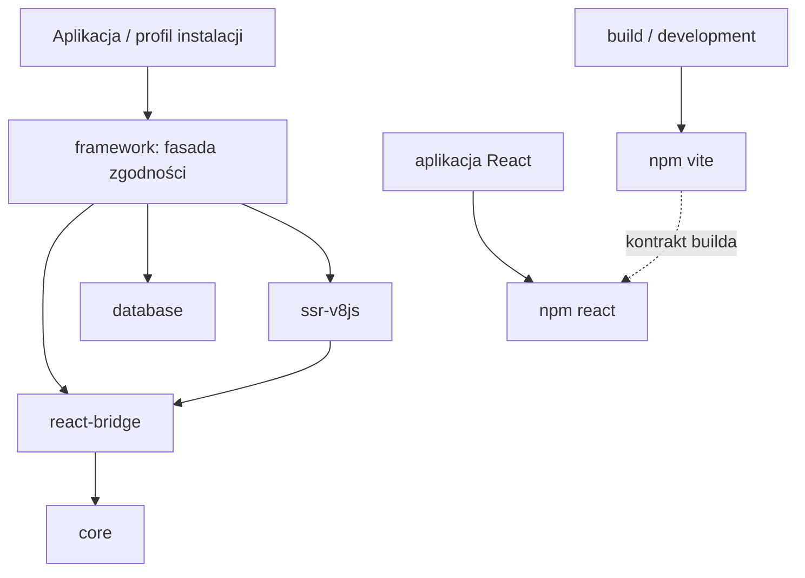

# Pakiety Yellow-Goose i kolejność wydzieleń

Decyzja architektoniczna z 2026-11-18. Baza analizy: b1e8000.

Aktualizacja wykonawcza: A0–A2 wdrożone i zweryfikowane lokalnie.
[Wyniki i zakres](a0-a2-implementation-2026-11-18.md). Poniższy plan opisuje punkt wyjścia i decyzje podziału. To plan, nie istniejąca
struktura dystrybucji. Obecnie wydawany lokalnie jest jeden pakiet Composer
`yellow-goose/framework`; aplikacja jest prywatnym projektem npm.

## 1. Granice i nazewnictwo

- Biblioteka udostępnia kod i publiczny kontrakt. Instalacja nie włącza automatycznie
  tras, migracji, zadań ani publicznego panelu.
- Moduł YG integruje biblioteki z aplikacją: rejestruje usługi, trasy, polityki,
  zasoby UI, migracje i komendy. Aplikacja jawnie go włącza.
- Bundle Symfony jest adapterem do Symfony. Nie nazywamy tak zwykłego pakietu YG.
- Bundle JavaScript jest wynikiem builda. Nie oznacza pakietu Composer ani modułu aplikacji.
- CMS, gra i edytor są kompozycjami pakietów. Reguły garażu/gry/ogrodu należą do aplikacji.

Jedno monorepo wystarczy. Każda granica dystrybucji ma własny composer.json lub
package.json, eksporty, dozwolone zależności i test niezależnego konsumenta.
Osobne repozytoria nie są warunkiem modularności. Nowych funkcji nie dopisujemy
do pakietu-fasady framework tylko dlatego, że obecnie wszystko tam leży.

## 2. Pierwsza fala: rozdzielenie istniejącego kodu

Nazwy i katalogi poniżej są propozycją do wdrożenia w etapie A1.

| Pakiet | Katalog docelowy | Własność | Zależności i ograniczenia |
| --- | --- | --- | --- |
| yellow-goose/core | packages/php/core | Request/Response/HttpException, routing, env i mały kontrakt rozszerzeń | PHP i JSON; bez PDO, V8Js, React, CMS i silnika 3D |
| yellow-goose/database | packages/php/database | Connection, Builder, Model, Migrator, później transakcje/CAS i repozytoria | PDO i sterownik aplikacji; nie wymaga React ani HTTP |
| yellow-goose/react-bridge | packages/php/react-bridge | PHP loadery, wybór strony, page protocol, Assets, obecne metadane i Renderer | core; nie wymaga ORM ani konkretnego renderera |
| yellow-goose/ssr-v8js | packages/php/ssr-v8js | Implementacja Renderer z V8Js i limity wykonania | react-bridge; runtime wymaga V8Js, bez Node |
| yellow-goose/framework | packages/framework | Przejściowa fasada ZoltaGaska Runtime, Session/CSRF, stare CLI i bootstrap zgodności | Składa poprzednie pakiety; nie jest miejscem nowych domen |
| @yellow-goose/react | packages/js/react | startClient, PageShell, navigation; później trwały layout i ClientOnly | React/React DOM jako peer dependencies; brak Babylon w zależnościach |
| @yellow-goose/vite | packages/js/vite | frameworkConfig, build klienta/SSR i supervisor developmentu | Narzędzie build/dev, Node; nie jest częścią produkcyjnego runtime PHP |

Kontrakt Renderer należy do react-bridge, kontrakt storage do assets itd.
Nie tworzymy centralnego pakietu contracts, który z czasem zacznie znać wszystkie domeny.
Jeśli konkretny interfejs jest potrzebny bez implementacji, ma mały publiczny entry
w pakiecie będącym właścicielem tej granicy.

Strzałka oznacza zależność. W nowej lekkiej aplikacji APP może zależeć bezpośrednio
od core albo react-bridge; fasada nie jest obowiązkowym korzeniem grafu.
Database jest niezależną biblioteką, a aplikacja wstrzykuje repozytorium do loadera.

## 3. Co trzeba naprawdę rozłączyć

| Dzisiejsze sprzężenie | Źródło | Zmiana przy ekstrakcji |
| --- | --- | --- |
| Runtime zawsze zna PDO, sesję, Assets i V8Js | packages/framework/src/Runtime.php:4–29 | Composition root aplikacji wybiera repozytoria, provider CSRF i Renderer; lekkie core ich nie tworzy |
| Application łączy HTTP z renderowaniem React | packages/framework/src/Http/Application.php:4–21 | Request/Response/router w core, page application w react-bridge |
| Frontend jest importowany z vendor | app/client.jsx:2, app/server.jsx:1, vite.config.js:2 | Docelowo eksporty npm; fasada nadal dostarcza samowystarczalne resources dla legacy bez wymagania nowych zależności npm |
| Jedno CLI zna DB i skrypt Node | packages/framework/src/Console/Cli.php:4–6,24–40,74–77 | Fasada zachowuje komendy; nowy bootstrap rejestruje komendy tylko z włączonych modułów; skrypt dev należy do npm vite |
| Test konsumenta zakłada jeden katalog vendor | tests/fixtures/consumer/check.php:5–9 | Test sprawdza właściwego właściciela klasy i brak App demo; nie wymusza starego katalogu |
| Migrator skanuje jeden katalog i zapisuje basename | packages/framework/src/Database/Migrator.php:12–20 | Dopiero przy modułach dochodzi rejestr (owner, migrationId), kolejność zależności i mapowanie starych migracji aplikacji |

Nie przenosimy równocześnie klas, nie przepisujemy ORM i nie wymieniamy nawigacji.
Ekstrakcja ma najpierw zachować zachowanie. Session/CSRF pozostaje w fasadzie w A1,
a w A2 przechodzi do security z zachowaniem jednej definicji klasy i zależności fasady.
PageDocument to przyszły kontrakt; A1 rezerwuje jego granicę, ale nie dodaje nowych
metadanych ani zachowania stron. Istniejące FQCN ZoltaGaska pozostają
obsługiwane przez mapy autoload pakietów; nie publikujemy dwóch definicji tej samej klasy.
Wprowadzenie nowych namespace wymaga osobnej wersji i warstwy zgodności.

Core-only oznacza bibliotekę HTTP/routera plus jawny bootstrap aplikacji konsumującej
Request/Route/Response. W A1 obecna Application zachowuje FQCN i kontrakt w react-bridge;
nie staje się automatycznie dispatcherem API bez React. Minimalny konsument core
sam wykonuje handler i mapuje błędy. Wspólny dispatcher modułów dochodzi dopiero w A2,
bez przenoszenia Assets ani protokołu stron do core. Bezpieczeństwo mutacji pozostaje
odpowiedzialnością aplikacji/security; sam Router go nie zapewnia.

## 4. Następne osobne pakiety, instalowane z potrzebą funkcji

| Pakiet / rodzina | Właściciel odpowiedzialności | Zależności projektowe |
| --- | --- | --- |
| yellow-goose/security | Identity, polityki projektów, provider sesji/CSRF i integracja auth | core; repozytorium użytkowników jest wstrzykiwane |
| yellow-goose/resources | Definicje zasobów, jawne query/actions, walidacja i serializacja schematu UI | core, security; adapter walidatora opcjonalny |
| yellow-goose/assets | Sesje uploadu, quarantine, wersje, dostęp i promocja do ready | core, security, database; port storage; dla pochodnych także jobs; natywne narzędzia bez Node |
| yellow-goose/jobs | Kontrakt zadania, dispatcher/worker i integracja outbox | Adapter transportu; nie zależy od CMS ani silnika 3D |
| yellow-goose/scene-api | Dokument sceny, jednostki, komendy, rewizje i polityki relacji | security, database, assets; publikacja zdarzeń przez port |
| yellow-goose/cms | Draft/published, treści i definicje zasobów CMS | resources, security, database; assets opcjonalne |
| yellow-goose/import-ifc | Mapowanie i zadania importu IFC | assets, jobs i narzędzia natywne w osobnym środowisku |
| yellow-goose/game-strategy | Kontrakty operacji czasowych i integracja rankingu | security, database, jobs; ekonomia, punkty i reguły rankingu konkretnej gry pozostają w App |
| yellow-goose/realtime | Port publikacji/subskrypcji, ticket i kontrakt reconnect | security; bez symulacji i konkretnego serwera; powstaje z pierwszym konsumentem push w D1 albo D2 |
| yellow-goose/realtime-openswoole | Transport WebSocket, limity i lifecycle połączeń | realtime + OpenSwoole; bez bridge SSR; porty są własnością realtime |
| @yellow-goose/ui | Form, DataTable, Dialog, AssetPicker; eksporty per funkcja | React; opcjonalnie TanStack; UI nie jest kontrolą dostępu |
| @yellow-goose/scene | Dokument/typy sceny, lifecycle, wybór i port viewera | Bez Babylon, CMS i protokołu konkretnej gry |
| @yellow-goose/babylon | Pierwszy adapter browser-only | scene + Babylon; brak importu silnika w entry SSR |
| @yellow-goose/editor | Inspector, gesty, undo, autosave i komendy | scene, ui, react/workspace; kontrakt scene-api przez klienta HTTP |

To katalog granic docelowych, nie polecenie założenia wszystkich pakietów w pierwszym PR.
W każdej fali powstają tylko pakiety potrzebne jej działającemu konsumentowi.
WorkspaceShell i integracja trwałego layoutu należą do subpathu
`@yellow-goose/react/workspace`, nie do nieopisanego pakietu workspace. Port viewportu
należy do scene; WorkspaceShell przyjmuje go przez props i nie importuje Babylon.
Gra 2D może używać tego samego layoutu bez zależności od adaptera 3D.
D1 z odpytywaniem HTTP nie wymaga realtime. Wybór SSE/Mercure w D1 uruchamia
wydzielenie jego portu publikacji/subskrypcji; pełny ticket/reconnect pokoju dochodzi
w D2. Pakiet nie czeka na D2, jeśli wcześniejsza fala ma rzeczywistego konsumenta push.

Adaptery infrastrukturalne, np. assets-flysystem i jobs-messenger, są osobnymi
opcjonalnymi implementacjami. Jobs nie wymaga obowiązkowo MySQL, Redis i RabbitMQ
równocześnie. Aplikacja wybiera jeden zestaw transportu i transakcji.
Adapter outbox musi korzystać z tego samego połączenia transakcyjnego co zapis domeny;
dodanie oddzielnego połączenia Doctrine do istniejącego PDO nie daje atomowości.

Serwer gry to osobna aplikacja/proces, np. apps/game-server, składająca transport,
konkretne reguły i repozytoria. Biblioteka realtime nie staje się silnikiem symulacji.
Konwerter IFC ma osobny obraz/proces, nie uruchamia się przy każdym żądaniu HTTP.
Zakaz Node obejmuje także worker uploadów i produkcyjną optymalizację modeli.
Natywny walidator/gltfpack są kandydatami opisanymi w planie funkcjonalnym;
automatyczny poster ma osobną bramkę renderera przed B1. Gotowy poster od redaktora
pozwala zacząć bez serwerowego WebGL. Wybór panelu przed komponentami B1 opisuje porównanie.

## 5. Profile instalacji i zakazane zależności

| Profil | Minimalny zestaw | Czego nie powinien wymagać |
| --- | --- | --- |
| API bez bazy | core + aplikacja | React, V8Js, PDO, npm, silnik 3D |
| React CSR | core + react-bridge; npm react i vite do builda | V8Js, ORM, CMS, Babylon |
| React SSR | poprzedni + ssr-v8js + rozszerzenie V8Js | Node, npm i node_modules na serwerze |
| CMS | bridge, security, resources, cms, wybrane persistence; npm ui | scene, IFC, game-server |
| Viewer | bridge, assets; npm scene + babylon | CMS, edytor, symulacja gry |
| Edytor | viewer + scene-api + npm editor | CMS i game-server |
| Gra na żywo | osobny server + security/persistence według gry; klient scene/2D | React SSR ani V8Js w procesie symulacji |
| Legacy demo | framework-fasada + dokładnie obecne integracje | Zmiany kodu App wymagane tylko przez przeniesienie klas |

Storage i zasoby techniczne Vite to inne odpowiedzialności: katalog modeli,
quarantine i prywatne pliki należą do assets, nie do bundlera frontendu.
Kernel nie zależy od pakietów domenowych. Żaden pakiet PHP runtime nie instaluje
Node ani nie odpala npm. Realtime nie wymaga V8Js. CMS nie importuje adaptera 3D.
React jest peer dependency bibliotek frontendowych, żeby nie tworzyć drugiej kopii hooków.

## 6. Integracja modułu i własność migracji

Composition root aplikacji zawiera jawną listę rozszerzeń i ich konfigurację.
Minimalny kontrakt modułu deklaruje stabilne ID, zależności, services, routes,
CLI, polityki oraz katalog migracji. Włączenie modułu nie wykonuje migracji.
Nie skanujemy dowolnego kodu vendor w poszukiwaniu funkcji do uruchomienia.

Routing plikowy App zachowuje obecny kontrakt. Moduły podłączają trasy przez rejestr
z jawnym prefiksem; konflikt nazw/tras przerywa boot. Moduł deklaruje wymagane polityki,
a composition root dostarcza implementację. Nie wolno wystawić trasy assets bez polityki.
Frontendowe komponenty/akcje mają statyczny rejestr eksportów z builda; definicja UI
z bazy nie może importować ani wykonywać arbitralnego JavaScriptu.

Migracja ma owner + migrationId. Rejestr wylicza kolejność zgodnie z zależnościami,
a uruchomienie odbywa się kontrolowaną komendą deploy, z blokadą migratora.
Istniejący wpis migracji aplikacji zachowuje tożsamość; nie uruchamiamy go ponownie
pod nową nazwą pakietu. Dla MySQL nie zakładamy atomowości DDL.
Odinstalowanie modułu nie usuwa automatycznie jego tabel i plików.

## 7. Zgodność i wymagania platformy

Fala ekstrakcji zachowuje deklarowane PHP >=8.1 i obecną zgodność namespace/protokołu.
Nowy adapter może wymagać nowszego PHP, ale manifest tego adaptera musi to deklarować.
Nie podnosimy minimum całego YG przez przypadkowe require najnowszego Symfony.
Symfony 6.4 wymaga PHP 8.1; Symfony 7.4 LTS wymaga PHP 8.2.
Źródła: [6.4](https://symfony.com/releases/6.4), [7.4](https://symfony.com/releases/7.4).
Dobór konkretnych wersji adapterów wymaga rozwiązywania zależności Composer w CI.

W pierwszej zgodnej ekstrakcji ssr-v8js zachowuje obecną semantykę: V8Js jest
sprawdzane podczas renderowania i jego brak daje kontrolowane 503; samo zainstalowanie
fasady nie może nagle uniemożliwić pracy CSR. Provider opisuje ext-v8js jako wymaganie
runtime SSR. Nowy ścisły profil SSR może wymagać rozszerzenia bezpośrednio w composer.json
aplikacji. Zmiana tej semantyki w pakiecie-fasadzie wymaga jawnej wersji niezgodnej.

Nowe aplikacje używają eksportów npm. A1 nie zastępuje starych zasobów vendor
prostym re-exportem do `@yellow-goose/*`: obecny konsument nie ma tych zależności
w package.json, a Composer ich nie instaluje. Archiwum framework-fasady zawiera
zgodne resources/client, server, PageShell, navigation, vite i dev z lokalnymi
importami, generowane przy wydaniu z jednego źródła. Nie wymagają skryptu instalacyjnego
ani npm na serwerze. CLI legacy nadal znajduje resources/dev.mjs. Nowe entry npm
i stare importy vendor testujemy osobno; migracja App do npm jest odrębnym krokiem.

Obecny build odwołuje się do wewnętrznego pliku React DOM
`cjs/react-dom-server-legacy.browser.production.js` (resources/vite.mjs:11),
a nie wyłącznie do publicznego API React. W A1 zachowujemy dokładny zestaw
React/React DOM 19.3.1, Vite 8.3.8 i plugin-react 6.3.0 z lockfile. Peer dependencies
react/react-dom nie obiecują szerszej zgodności SSR; ewentualny szerszy zakres CSR
wymaga osobnego profilu i testu. Brak wewnętrznego entry przerywa build czytelnym
błędem. Zmianę wersji dopuszcza dopiero rzeczywisty bundle w V8Js, zgodne useId
i hydracja w przeglądarce; sam npm install i ABI handshake nie wystarczą.

Renderer PHP i runtime npm uzgadniają protocolVersion oraz
bundleAbiVersion; to różne wartości od buildVersion i revision dokumentu sceny.
Niezgodny ABI ma zakończyć się kontrolowanym błędem przed próbą renderowania.
W A1 fasada rozpoznaje brak metadanych ABI jako format bazowego builda b1e8000;
ścisły kontrakt nowych aplikacji nie może unieważnić dotychczasowego builda legacy.
Wspólny numer wydań pierwszej fali ogranicza macierz; nie wymaga wspólnego numerowania na zawsze.

## 8. Własny kod i biblioteki zewnętrzne

| Obszar | Decyzja |
| --- | --- |
| Walidacja | Adapter Symfony Validator do sprawdzania danych; schemat React to tylko jawny wspierany podzbiór constraints |
| Storage | Flysystem dla operacji plikowych; vendor SDK dla gwarancji VersionId/conditional copy, których ogólny interfejs nie zapewnia |
| Jobs | Adapter Messenger jako kandydat; outbox i receipts pozostają częścią kontraktu zapisu domeny |
| Tabele | TanStack Table jako biblioteka UI; osobny React Admin data provider tylko jeśli wybierzemy gotowy panel |
| 3D | Babylon/Three jako zależność wybranego adaptera; nie piszemy renderera GPU |
| YG | Własny bridge PHP–React/V8Js, protokół stron, scena, komendy i integracja workspace |

Porównanie i źródła: [istniejące frameworki](framework-comparison-2026-11-18.md).
Nie dodajemy zależności w tym zadaniu; nie sprawdzono jeszcze ich rozwiązania razem z YG.

## 9. Fale i kryteria zakończenia

| Fala | Zakres | Dowód wymagany przed przejściem dalej |
| --- | --- | --- |
| A0 | Inwentaryzacja publicznych FQCN, ścieżek JS, CLI, protokołów i migracji | Macierz zgodności i wyjściowy konsument legacy |
| A1 | Wydzielenie core/database/react-bridge/ssr-v8js oraz npm react/vite | Każdy manifest, DAG, fizyczna instalacja; legacy bez nowych npm oraz nowa aplikacja z paczek npm; rzeczywisty SSR i hydracja |
| A2 | Jawna rejestracja modułów i migracji; security i resources | API bez React/PDO; CSR bez V8Js; własność tras/migracji; odrzucenie niebezpiecznej akcji |
| B1 | Workspace/UI + assets + minimalny jobs przed pochodnymi | Stały viewport, bezpieczna finalizacja uploadu, retry workera, opublikowany gotowy GLB |
| B2 | CMS/konfigurator jako referencyjna aplikacja | Publikacja, formularz, tabela, potwierdzona konfiguracja i brak zależności od game/IFC |
| C | Editor i następnie import-ifc | Rewizje, undo, jednostki, izolowany import rzeczywistej próbki |
| D | Strategia, a osobno runtime gry na żywo | Atomowe koszty; autorytatywny wynik, fencing pokoju i odzyskanie po awarii |

Każda fala kończy się działającym konsumentem. Testy pakietów mają używać
zbudowanego archiwum/paczki i fizycznych instalacji, nie tylko workspaces/symlinków.
Root node_modules współdzielone w obecnym tests/package.py nie dowodzi jeszcze
poprawności publikacji npm ani braku ukrytych zależności. Nowy konsument instaluje
archiwa npm poza monorepo, bez odziedziczonego node_modules/NODE_PATH, oraz buduje
klienta i SSR. Osobny legacy fixture zachowuje stare importy i package.json bez
`@yellow-goose/*`; sprawdza też help/dev CLI oraz nawigację.
Każdy pakiet otrzymuje w A0 listę eksportów, platform requirements i plików archiwum;
A1 zaczyna się po sprawdzeniu tej macierzy, nie po domniemaniu, że przeniesienie plików wystarczy.

Docelowa macierz CI: core-only bez PDO/React; CSR bez V8Js; SSR w PHP bez binarki
Node i bez wykonywania procesów; legacy demo; CMS bez scene; viewer bez CMS/game;
worker importu bez HTTP/SSR; serwer gry bez V8Js. Klientowy build musi wykazać,
że CMS nie pobiera silnika 3D, a bundle SSR nie zawiera kodu silnika browser-only.

## 10. Wycofanie i aktualizacje

Najpierw wydzielenie kodu bez zmiany danych. Następnie expand/contract:
nowe struktury i odczyt starej wersji przed przełączeniem zapisów. Każdy adapter
ma jawny zakres schemaVersion, który umie odczytać. Nie konwertujemy automatycznie
wszystkich dokumentów przy starcie aplikacji.

Wycofanie modułu oznacza wyłączenie jego integracji albo powrót do zgodnej wersji kodu,
nie DROP tabel. Zmiana formatu dokumentu wymaga snapshotu i testu odtworzenia.
Powrót do starego kodu jest dozwolony tylko, gdy czyta już zapisane wersje;
w przeciwnym razie wyłączamy nowe zapisy i wykonujemy przygotowane odtworzenie.

Można rozpocząć A0. A1 ma techniczną bramkę macierzy zgodności z A0; nie wymaga
ponownej decyzji biznesowej o późniejszych produktach. Wybór pełnego zakresu CAD, parametrów gry
i infrastruktury jest bramką późniejszych fal, opisaną w [planie funkcjonalnym](3d-framework-expansion-2026-11-13.md).
